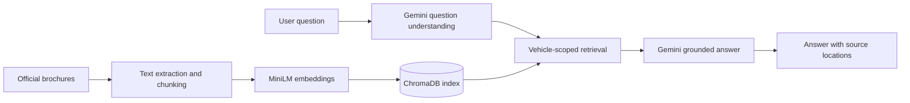

# AutoSaarthi India

**A brochure-grounded RAG assistant for researching cars in India.**

AutoSaarthi helps buyers ask questions about vehicles and compare models using information retrieved from indexed car brochures. Answers are grounded in retrieved passages, with brochure and page or section references shown in the app.

## Features

- Ask questions in natural language, including common spelling mistakes and follow-up questions.
- Compare selected vehicles using evidence retrieved for each model.
- Browse predefined questions, search indexed brochure passages, and view source locations.
- Add PDF or DOCX brochures when running locally.
- Browse official manufacturer and vehicle-safety portal links.
- Show an immediate safety response for urgent brake, fire, smoke, and high-voltage battery concerns.

## How it works



## Technology

| Area | Technology |
| --- | --- |
| Web app | Python, Flask |
| Vector search | ChromaDB with per-vehicle retrieval |
| Embeddings | `sentence-transformers/all-MiniLM-L6-v2` through FastEmbed ONNX |
| Question understanding and answers | Google Gemini API |
| Documents | PDF and DOCX extraction |

## Run locally on Windows

You need Python 3.11 or newer and a Gemini API key.

```powershell
py -m venv .venv
.venv\Scripts\Activate.ps1
pip install -r requirements.txt
Copy-Item .env.example .env
```

Add your key to `.env`:

```text
GEMINI_API_KEY=your-key
GEMINI_MODEL=gemini-3.5-flash-lite
```

Keep `.env` private. Then start the app:

```powershell
python app.py
```

Open [http://127.0.0.1:8080](http://127.0.0.1:8080). You can also use `start_app_windows.bat`.

To index your own brochures, place them under `Data/sources/`, update `Data/catalog.csv`, then run:

```powershell
python ingest_corpus.py
```

Do not commit private documents or API keys.

## Live preview

- **App:** [autosaarthi-india.onrender.com](https://autosaarthi-india.onrender.com)
- **Repository:** [github.com/KMRakshithGowda/AutoSaarthi](https://github.com/KMRakshithGowda/AutoSaarthi)

The app is hosted on Render's free plan. It may take around a minute to wake after inactivity. The hosted preview uses the preloaded Chroma index; live uploads and original PDF downloads are disabled there. They remain available for local use.

## Project structure

```text
app.py                 Flask routes and chat flow
src/rag.py             Document ingestion and retrieval
Data/                  Catalogue, question bank, manifest, and portal links
chroma_db/             Prebuilt brochure text index
templates/             HTML interface
static/                CSS and JavaScript
render.yaml            Render service configuration
Dockerfile             Hosted app image
```

## Scope and limitations

AutoSaarthi is designed to answer vehicle questions from indexed brochure passages. If the requested vehicle is not indexed, it returns `Sorry, I have no information about it.` If a detail is absent from the supplied source, it says so. Check the displayed source location before relying on a specification; the app does not independently verify manufacturer claims or current vehicle availability.

The app has been manually exercised with brochure questions. A formal held-out evaluation with measured retrieval and answer-accuracy results has not yet been published.

## Data and secrets

The public repository includes the prebuilt ChromaDB text index and manifest, but not the original brochure PDFs or API key. Only index documents you have permission to share. Keep `.env` private; it is excluded from Git.
